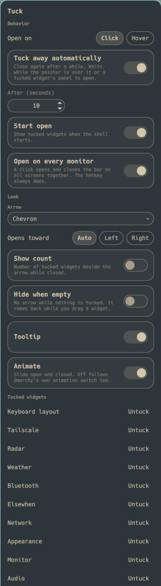

# Tuck

Tuck the bar widgets you rarely need behind a divider on the [Omarchy](https://omarchy.org) bar. Click the arrow, press a hotkey, or let it fold itself away again after a few seconds.

Tucked away:


Open:




Everything is adjustable from a right-click on the arrow: click or hover to open, auto-hide timing, arrow style, which way it opens, a count badge, and a list of tucked widgets to untuck with one click.

<br clear="right">

## Requirements

Omarchy 4.5 or newer (the Quickshell-based shell). Nothing else to install.

## Install

```bash
omarchy plugin add https://github.com/twodxme/omarchy-tuck.git --enable
```

Tuck lands on the bar as `tim.tuck`. Move it where you want the divider, for example the start of the right section:

```bash
omarchy bar move tim.tuck --section right --index 0
```

## Update

```bash
omarchy plugin update tim.tuck
omarchy restart shell
```

The restart matters: the shell keeps running a plugin's previous code until it restarts.

**Coming from 1.0:** right-click on the arrow now opens settings. It used to switch auto-hide off, so if Tuck stopped tucking itself away for you, that's why; turn it back on in settings.

## Remove

1. Bring tucked widgets back first: right-click the arrow and press **Untuck all**. Without Tuck nothing shows the bar's `tray` section, so anything left there disappears from the bar.
2. Remove the plugin:

   ```bash
   omarchy plugin remove tim.tuck
   ```

3. If you bound a hotkey (see [Hotkey](#hotkey)), delete that line from `~/.config/hypr/bindings.lua`.

Prefer Omarchy's stock tray instead? Skip step 1 and add `omarchy.tray` to the bar: it shows the same `tray` section.

## Use

- **Click** the arrow to show or hide the tucked widgets.
- **Drag** a widget along the bar and the divider opens: drop it inside to tuck it, drag one out to bring it back. Tucked widgets keep working exactly as they do on the bar, panels included.
- **Right-click** the arrow for settings, including a list of tucked widgets with **Untuck** buttons.
- **Auto-hide** folds the divider again 10 seconds after it opens. The countdown pauses while the pointer is over it, while you drag, and while a tucked widget's panel is open.

Or tuck widgets from the command line; they live in the bar's `tray` section:

```bash
omarchy bar move omarchy.bluetooth --section tray
```

## Hotkey

Tuck answers over the shell's IPC, on every monitor at once:

```bash
omarchy-shell tim.tuck toggle          # or expand / collapse
omarchy-shell tim.tuck openSettings    # on the focused monitor; or closeSettings
```

Bind it in `~/.config/hypr/bindings.lua`:

```lua
o.bind("SUPER + BACKSLASH", "Tuck", "omarchy-shell tim.tuck toggle")
```

## Settings

Right-click the arrow, or set them from a script. Every setting is optional; a value Tuck doesn't understand falls back to its default.

| Setting | Values | Default | What it does |
|---|---|---|---|
| `openOn` | `click`, `hover` | `click` | Click the arrow, or open while the pointer is over it and close shortly after it leaves. |
| `autoHide` | `true`, `false` | `true` | Click mode: close again on its own. |
| `autoHideSeconds` | 1–300 | `10` | How long it stays open. The countdown waits while the pointer is over it, while you drag, and while a tucked widget's panel is open. |
| `startOpen` | `true`, `false` | `false` | Show tucked widgets when the shell starts. |
| `syncMonitors` | `true`, `false` | `true` | A click opens every monitor's bar together. The IPC toggle always does. |
| `iconStyle` | `chevron`, `arrow`, `caret`, `double`, `dots` | `chevron` | The divider's glyph. |
| `openToward` | `auto`, `start`, `end` | `auto` | Which side the widgets open on. `auto` opens away from the section's fixed edge; `start` is left (up on a vertical bar), `end` is right (down). |
| `showCount` | `true`, `false` | `false` | Number of tucked widgets beside the arrow while closed. |
| `hideWhenEmpty` | `true`, `false` | `false` | No arrow while nothing is tucked; it reappears while you drag a widget. |
| `showTooltip` | `true`, `false` | `true` | Hover tooltip on the arrow. |
| `animate` | `true`, `false` | `true` | Slide open and closed. Omarchy's own animation switch also turns it off. |

```bash
omarchy bar set tim.tuck openOn hover
omarchy bar set tim.tuck autoHideSeconds 30
omarchy bar set tim.tuck iconStyle caret
```

### Recipes

- **Declutter, out of sight:** `hideWhenEmpty true`, `showTooltip false`, and use the hotkey.
- **Stock-tray feel:** `openOn hover`.
- **Arrow in front of the tucked widgets instead of after them:** `openToward end` on a divider in the right section (`start` does the same in the left section).
- **Keep it open while you work, tuck when presenting:** `autoHide false`, then the hotkey.

## Notes

- Tuck hosts the bar's `tray` section, the same one Omarchy's stock tray (`omarchy.tray`) opens in its drawer. Use one or the other: if both are on the bar, Tuck says so in its tooltip and settings.
- Works on top, bottom, left and right bars. On a vertical bar the divider opens downward or upward.
- English strings ship in `i18n/en.json`; other Omarchy languages fall back to them. Translations welcome.

## Develop

```bash
node tests/model.test.js
omarchy plugin validate .
```

Changes to `shell.json` settings apply live. Changes to `Tuck.qml`, `TuckSettings.qml` or `TuckModel.js` need `omarchy restart shell`: the shell logs "reloading" on save but keeps the compiled component until it restarts.

## Changes

- **1.1.1:** **Untuck works** (in 1.1.0 it silently did nothing: Omarchy lets only bar plugins rewrite the layout, so it now goes through `omarchy bar move`). `openSettings` opens on the focused monitor. A warning when Omarchy's stock tray is also on the bar. The settings popup is built only while it's open instead of living in every monitor's bar. Tests run on GitHub.
- **1.1.0:** settings popup (right-click), hover mode, auto-hide timing, arrow styles, open direction, count badge, hide when empty, per-monitor clicks, start open, untuck from settings, `openSettings`/`closeSettings` IPC.
- **1.0.0:** first release.

## License

MIT
